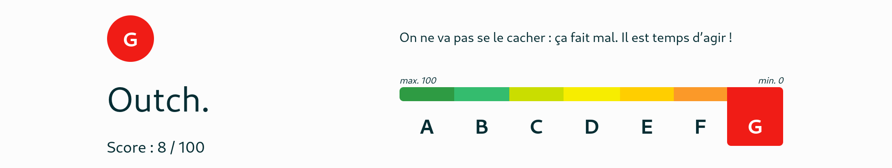
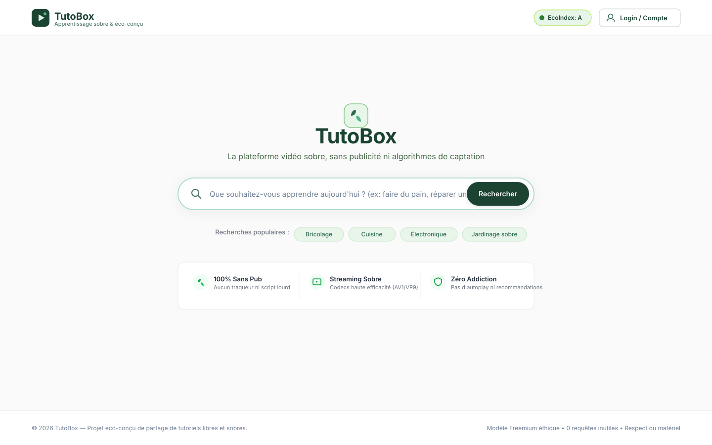
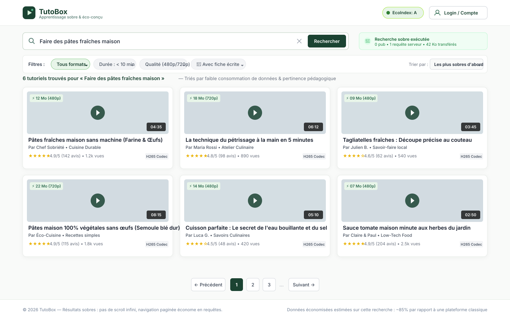
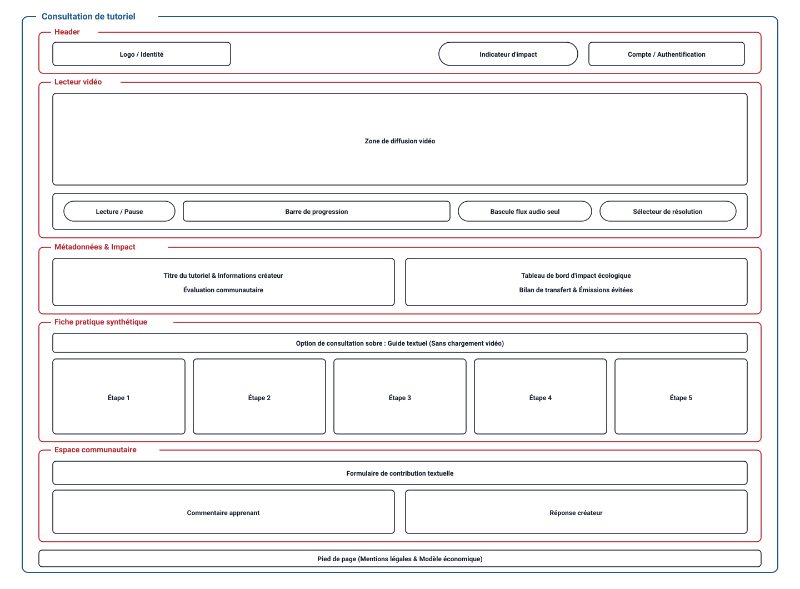

# TutoBox

## Introduction

Aujourd’hui, le streaming vidéo représente [entre 53.7 %](https://spacelift.io/blog/how-much-data-is-generated-every-day) du trafic Internet mondial, YouTube absorbant à lui seul [jusqu’à 14.6 %](https://spacelift.io/blog/how-much-data-is-generated-every-day) de la bande passante descendante du globe. Si les progrès technologiques ont réduit l'intensité énergétique unitaire par heure de visionnage (entre [46 gCO₂e](https://www.iea.org/commentaries/the-carbon-footprint-of-streaming-video-fact-checking-the-headlines)), les émissions globales d'Alphabet ont bondi de [57 %](https://www.smartenergydecisions.com/wp-content/uploads/2025/04/google-2024-environmental-report.pdf) en cinq ans, illustrant un effet rebond massif alimenté par la course aux très hautes résolutions (4K/8K) et la prolifération de fonctionnalités superflues. L’empreinte environnementale du service ne réside pas seulement dans les serveurs, mais d'abord sur les terminaux utilisateurs ([50 à 70 %](https://computingwithinlimits.org/2022/papers/limits22-final-Makonin.pdf) de l'impact) et dans des interfaces web surchargées : le site de YouTube écope d’un score EcoIndex désastreux ([classe G](https://www.ecoindex.fr/)) en raison de scripts invasifs, d'un arbre DOM pléthorique et de flux vidéo maintenus même lorsqu'ils sont hors champ (soit environ [323 000 tCO₂e / an](https://www.fastcompany.com/90346595/the-internets-youtube-habit-has-the-carbon-footprint-of-a-small-city) évitables).

Face à cette dérive, le projet TutoBox propose une alternative dédiée à l'apprentissage et guidée par la sobriété numérique. En reprenant l'efficacité pédagogique de la vidéo tout en intégrant une écoconception stricte (allègement drastique de l'interface, résolutions adaptées à l'échelle d'apprentissage, suspension du flux vidéo masqué et absence d'algorithmes de captation de l'attention), TutoBox prouve qu'il est possible de transmettre le savoir sans saturer les réseaux ni épuiser les ressources planétaires.

---

## De YouTube vers TutoBox : Grille d'évaluation sociotechnique

### 1. Plan médico-social

- **Apprentissage et émancipation technique :** Facilite la montée en compétences en autonomie dans des domaines variés (programmation, artisanat, réparation d'objets, sciences), favorisant l'apprentissage tout au long de la vie sans distraction attentionnelle.
- **Santé publique et prévention des risques :** Diffusion rapide et accessible de tutoriels d'intérêt général (gestes de premiers secours, réflexes en cas d'accident, prévention sanitaire, ergonomie).
- **Santé mentale et sobriété cognitive :** En éliminant le design persuasif (recommandations algorithmiques addictives, notifications anxiogènes, lecture automatique), la plateforme protège l'attention des usagers et réduit la fatigue numérique.
- **Lien social et valorisation humaine :** Création d'opportunités d'entraide communautaire et génération d'emplois locaux dédiés à l'animation, la modération éthique et la maintenance technique de l'infrastructure sobre.

### 2. Plan du développement d'un territoire

- **Souveraineté fiscale et économique :** Contrairement aux modèles des multinationales du numérique (comme Alphabet) recourant à l'optimisation fiscale transfrontalière, TutoBox s'inscrit dans l'économie locale et contribue directement aux recettes publiques territoriales (notamment via l'impôt sur les sociétés).
- **Épanouissement des populations et résilience locale :** Démocratisation des savoirs pratiques et valorisation des savoir-faire régionaux (circuits courts, low-tech, maintenance locale). La faible bande passante requise permet un accès équitable aux formations, y compris dans les zones rurales ou à connectivité limitée.
- **Emplois locaux durables :** Soutien à des emplois techniques et pédagogiques non délocalisables (hébergement souverain, maintenance logicielle éco-conçue, médiation numérique et accompagnement de proximité).

### 3. Démocratie technique

- **Marge d’appropriation :** Les apprenants et créateurs ne sont plus de simples consommateurs passifs d'un algorithme opaque, mais des acteurs qui s'approprient un outil transparent, configurable et adapté à leurs besoins réels.
- **Intelligibilité et clarté du système :** Conception intuitive sans pièges ergonomiques (_dark patterns_). L'usager maîtrise son parcours : la navigation est directe, sans fioritures, et les impacts de ses choix techniques (résolution, consommation de données) lui sont explicites.
- **Gouvernance et implication des usagers :** Mise en place de canaux de retour d'expérience (_feedback_) et consultation régulière des utilisateurs pour faire évoluer la plateforme selon des besoins d'intérêt général et non des impératifs publicitaires.
- **Utilité collective prioritaire :** Recentrage de l'outil sur des finalités sociales tangibles (transmission du savoir, culture, éducation) plutôt que sur la captation et la monétisation du « temps de cerveau disponible ».

### 4. Substitution effective à des dispositifs existants

- **Alternative éco-conçue et ciblée :** TutoBox se positionne comme une substitution directe à l'usage éducatif de plateformes généralistes comme YouTube, en expurgeant les couches superflues (scripts publicitaires lourds, traqueurs, modules d'engagement artificiel).
- **Optimisation de l'encodage et de la compression :** Utilisation de codecs vidéo modernes à haute efficacité de compression (tels que le H.265/HEVC, VP9 ou AV1) pour réduire drastiquement le volume de données transféré par rapport aux formats plus anciens (comme le H.264/AVC, historiquement conservé par commodité et coût de licences).
- **Diffusion sobre et adaptative :** Limitation des résolutions aux stricts besoins pédagogiques (la 480p ou 720p suffit amplement pour un tutoriel) et coupure automatique de la vidéo lorsque le lecteur sort du champ de vision ou que l'onglet est inactif (passage en flux audio seul).
- **Dashboard de sensibilisation :** Intégration d'un tableau de bord de suivi d'impact (données consommées en Mo, estimation gCO₂e évitée) afin de rendre visible la matérialité du numérique et d'encourager des usages responsables.

### 5. Effet rebond : analyse critique et leviers de régulation

- **Surconsommation induite (Effet Jevons) :** Rendre l'accès aux vidéos plus léger, plus rapide et moins coûteux risque paradoxalement d'encourager un visionnage compulsif et démultiplié, venant annuler les gains énergétiques par unité consommée.
- **Multiplication des infrastructures :** L'émergence d'une nouvelle plateforme risque d'additionner des serveurs supplémentaires sans nécessairement faire disparaître les infrastructures existantes, accentuant la consommation électrique globale si la substitution n'est pas totale.
- **Inflation des formats (texte vs vidéo) :** Tendance à privilégier une vidéo de 10 minutes (plusieurs centaines de mégaoctets) là où une fiche technique ou un texte illustré de quelques dizaines de kilo-octets suffirait pour documenter une démarche.
- **Bénéfice net sur la mobilité :** La formation à distance par tutoriels permet d'éviter des déplacements physiques en véhicule, à condition que le coût environnemental des données transférées demeure inférieur à celui du transport évité.
- **Dispositifs de régulation intégrés à TutoBox :**
  - Suppression radicale de la lecture automatique (_autoplay_) et du défilement infini de suggestions.
  - Mise en avant de résumés textuels, schémas synthétiques et chapitrages précis, évitant de charger une vidéo complète pour consulter une information ponctuelle.
  - Mesure et transparence de l'empreinte pour inciter à l'auto-régulation.

---

## Plateformes de référence et scénarios d'usage

### Plateformes et alternatives de référence

TutoBox s'évalue et se positionne face à plusieurs acteurs existants de la vidéo et du tutoriel :

- **Plateformes vidéo généralistes :** YouTube, Dailymotion, Vimeo
- **Plateformes de cours, académiques et tutoriels :** Tuto.com, POD UTT

### Scénarios utilisateurs

#### 1. Scénario : « Apprendre à faire des pâtes »

1. **Besoin initial :** L'utilisateur ne trouve pas l'information dans des livres ou à portée de main.
2. **Accès à la plateforme :** Ouvre le navigateur et se rend sur **TutoBox**.
3. **Recherche :** Fait une recherche par mots-clés.
4. **Sélection :** Clique sur le tutoriel avec le meilleur ratio like / dislike ou le plus consulté.
5. **Consultation :** Regarde le premier tutoriel.
6. **Résultat :** L'utilisateur sait faire des pâtes.

#### 2. Scénario : « Apprendre à faire des pâtes (l’utilisateur connaît un créateur) »

1. **Besoin initial :** L'utilisateur ne trouve pas l'information dans des livres ou à portée de main, mais connaît déjà un créateur.
2. **Accès à la plateforme :** Ouvre le navigateur et se rend sur **TutoBox**.
3. **Recherche :** Fait une recherche par créateur.
4. **Sélection :** Clique sur le tutoriel qui correspond.
5. **Résultat :** L'utilisateur sait faire des pâtes.

## Impact de l'exécution des scénarios auprès de différents services concurrents

L'EcoIndex d'une page (de A à G) est calculé (à l'aide des outils tels que [EcoIndex](https://www.ecoindex.fr/) ou [GreenIT](https://www.greenit.fr/)) en fonction du positionnement de cette page parmi les pages mondiales concernant:

- Le nombre de requêtes lancées
- Le poids de la page
- Le nombre d'éléments de la page

Nous avons donc comparé l'impact des scénarios sur les différents sites qui fournissent un l'accès à des tutoriels: YouTube, tuto.com, Vimeo, DailyMotion, POD UTT.

| Site Web    | Score (sur 100) | Classe | Détail des mesures                                                           |
| ----------- | --------------- | ------ | ---------------------------------------------------------------------------- |
| POD UTT     | 61/100          | C      | [Plus de détails](Benchmark/POD_UTT/EcoIndex-environmental-statement.md)     |
| DailyMotion | 24/100          | F      | [Plus de détails](Benchmark/DailyMotion/EcoIndex-environmental-statement.md) |
| Vimeo       | 18/100          | F      | [Plus de détails](Benchmark/Vimeo/Ecoindex-environmental-statement.md)       |
| tuto.com    | 15/100          | F      | [Plus de détails](Benchmark/Tuto.com/EcoIndex-environmental-statement.md)    |
| YouTube     | 8/100           | G      | [Plus de détails](Benchmark/YouTube/EcoIndex-environmental-statement.md)     |

**Tab 1:** Mesure de l'EcoIndex moyen des service fournissant l'accès aux tutoriels.

Les mesures de l'impact de ces services révèlent des disparités notables : les plateformes commerciales grand public présentent des classes EcoIndex très faibles (F, et G pour YouTube), tandis qu'une plateforme sobre comme POD UTT atteint la classe C (61/100).

Dans le détail, les pages les plus mal classées sont celles qui incluent:

- Des vidéos
- Des designs graphiques très lourds
- Des traqueurs en très grand nombre
- Des publicités en grand nombre

Il est donc nécessaires d'appliquer des pratiques d'écoconception et un modèle économique permettant de réduire le recours à des services publiciataires et de traqueurs.

## Modèle économique

Comme nous l'avons vu dans la section précédente, parmi les choix de conception ayant un important impact environnemental, la plupart sont directement liés au modèle économique du service. C'est pourquoi il est donc nécessaire d'effectuer une analyse profonde de ces modèles économiques afin de choisir un meilleur modèle économique pour la conception de notre projet.

En effet, le monde du streaming vidéo est un domaine assez capitaliste où la réalisation des profits passe avant la réduction de l'impact environnementale du produit. Au vue de la concurrence dans ce secteur chaque plateforme de streaming vidéo ou de tutoriels disposent de son propre modèle économique afin d'attirer le plus d'utilisateurs.

| Plateforme      | Modèle d'accès                         | Source de financement                                | Publicités & Traqueurs                   |
| --------------- | -------------------------------------- | ---------------------------------------------------- | ---------------------------------------- |
| **YouTube**     | Gratuit / Freemium (_YouTube Premium_) | Publicités ciblées (Google Ads), abonnements payants | Publicités omniprésentes, traçage massif |
| **DailyMotion** | Gratuit                                | Publicités vidéo (régies tierces)                    | Publicités pré/mid-roll, traqueurs tiers |
| **Vimeo**       | Freemium                               | Abonnements créateurs et entreprises                 | Aucune publicité tierce sur les vidéos   |
| **tuto.com**    | Payant (à l'acte ou abonnement)        | Achat direct de formations, abonnements              | Absence de traqueurs publicitaires tiers |
| **POD UTT**     | Gratuit                                | Financement public / institutionnel (université)     | Aucune publicité, aucun traqueur         |

**Tab. 2 :** Offre des services de diffusion vidéo et tutoriels.

Les offres de service numérique des plateformes de vidéo et de tutoriels (cf. Tab. 2) se sont principalement polarisées autour de deux modèles :

- un accès gratuit financé par la publicité et la captation de l'attention (YouTube, DailyMotion), qui génère une surcharge de requêtes, des traqueurs invasifs et une course aux clics écologiquement insoutenable ;
- un accès payant (par abonnement ou achat unitaire comme tuto.com et Vimeo) ou institutionnel (POD UTT), qui élimine les traqueurs publicitaires mais peut représenter une barrière d'entrée immédiate pour les apprenants.

Afin de concilier accessibilité, pérennité et sobriété numérique, **TutoBox** fait le choix d'exclure totalement la publicité et propose un modèle de type **Freemium avec période d'essai** :

- **Période d'essai pour les apprenants :** Les utilisateurs peuvent accéder gratuitement au système de façon limitée pendant une période d'essai d'**une semaine avec 10 vidéos incluses** ;
- **Abonnement standard :** S'ils souhaitent visionner davantage de vidéos, l'accès bascule sur un système d'abonnement standard à prix modéré (**7 € / mois**) ;
- **Exonération pour les créateurs :** Les créateurs de contenu sont totalement exonérés de cette limite pour publier des vidéos ;
- **Gratification par paliers (_milestones_) :** Si les créateurs atteignent un certain palier (_milestones_), ils peuvent accéder à toute la plateforme gratuitement.

| Source de revenus       | Montant unitaire | Quantité nécessaire pour financer un salaire[^1] |
| ----------------------- | ---------------- | ------------------------------------------------ |
| **Abonnement standard** | 7 € [^2]         | 501                                              |

**Tab. 3 :** Source de revenus retenue pour le service TutoBox.

L'étude de l'offre des plateformes existantes (cf. Tab. 2) et l'évaluation des besoins financiers (cf. Tab. 3) nous ont permis d'établir que :

- le recours à la publicité est incompatible avec les objectifs de sobriété de TutoBox : il dégrade drastiquement le score EcoIndex, alourdit les pages en scripts de traçage et incite structurellement au visionnage compulsif ;
- un modèle économique sain et 100 % sans publicité est pleinement viable : avec un abonnement standard accessible fixé à 7 €, seuls **501 abonnements** sont nécessaires pour financer le salaire médian d'un employé (3 507 €) ;
- l'exonération des créateurs et l'accès gratuit par paliers (_milestones_) encouragent l'enrichissement de la plateforme en tutoriels de qualité tout en maintenant un modèle équilibré et autonome.

Par conséquent, pour réduire drastiquement l'impact écologique du service tout en garantissant sa viabilité économique, nous proposons de :

- renoncer totalement et définitivement à toute forme de publicité et de traqueurs ;
- baser le modèle de financement exclusivement sur l'abonnement standard (7 € / mois) ;
- instaurer une période d'essai gratuite et sobre (1 semaine avec 10 vidéos incluses) pour faciliter l'accès initial aux savoirs ;
- exonérer les créateurs de limites pour publier des tutoriels et leur offrir la gratuité complète dès l'atteinte de jalons (_milestones_).

[^1]: Basé sur un salaire médian chargé estimé à 3 507 € pour financer un employé.

[^2]: Montant unitaire de l'abonnement standard TutoBox (3 507 € / 7 € = 501 abonnements nécessaires).

---

## Maquette de l'interface et échantillon de données

Au vu des différents services comparés, des exigences environnementales exprimées plus haut et des scénarios retenus, nous avons défini pour notre prototype une maquette de l'interface et un échantillon de données réalistes.

Les ressources Web possédant une représentation sur notre application sont structurées autour des objets métiers suivants :

- **Le point d'entrée du service** (avec une HTTP-URI ayant pour chemin `/`) ;
- **La recherche et filtrage de tutoriels**, accessible via la commande de recherche `search` (avec pour chemin `/search?q={query}`), ou plus spécifiquement filtrée par rubrique thématique (`/search?topic={name}`) ou par créateur (`/search?creator={name}`) ;
- **Le tutoriel** (avec pour chemin `/tutorials/{id}`), représentant l'objet métier central du tutoriel avec son lecteur vidéo éco-conçu, ses métadonnées techniques, son indicateur d'impact environnemental et sa fiche textuelle synthétique.

### Maquettes de l'interface

#### a. Point d'entrée sobre (`/`)

Le point d'entrée propose une interface épurée centrée sur un champ de recherche direct, des raccourcis vers les thématiques sobres courantes et un rappel des engagements écologiques du service, sans flux vidéo en arrière-plan ni recommandations superflues.

#### b. Recherche et filtrage de tutoriels (`/search?q={query}`)

La commande de recherche présente les résultats sous forme de cartes synthétiques allégées, avec des filtres sobres (durée, format, qualité 480p/720p, présence d'une fiche écrite). Pour l'affichage de ces résultats, un composant réutilisable « aperçu » est créé et réutilisé pour chaque aperçu de tutoriel, garantissant une cohérence visuelle et une modularité optimale du code. Chaque aperçu affiche explicitement son coût estimé en transfert de données et en émissions carbone.

#### c. Consultation et visionnage d'un tutoriel (`/tutorials/{id}`)

Le tutoriel intègre un lecteur sans lecture automatique (_autoplay_), diffusant par défaut en résolution éco (480p) avec bascule en flux audio seul et coupure automatique lorsque l'onglet est inactif. Une fiche résumée étape par étape permet d'accéder directement à l'information sans charger l'intégralité du média vidéo.

**Fig. 1 :** Maquette de l'interface du prototype : a. Point d'entrée sobre (`/`), b. Recherche et filtrage de tutoriels (`/search?q={query}`), c. Consultation et visionnage d'un tutoriel (`/tutorials/{id}`).

### Échantillon et modèle de données

Dans un objectif de sobriété environnementale, les tutoriels sont pour l'instant limités à un échantillon restreint et représentatif (soit `20` à `30` tutoriels ciblant les scénarios pratiques : cuisine sobre, réparation, bricolage, jardinage).

Pour des raisons de respect des droits d'auteurs, nous utilisons des données générées (avec [`dummy-json`](https://github.com/webroo/dummy-json/blob/master/README.md)).
Bien que fictives, ces données correspondent rigoureusement à la structure des services concurrents et aux exigences de sobriété : chaque tutoriel comporte un titre (`heading`), une rubrique (`section`), une date de publication (`issued`), des informations sur l'auteur (`creator`), une durée (`duration_seconds`), des métriques d'impact écologique (`eco_metrics` : résolution par défaut, volume transféré en Mo, émissions gCO₂e évitées, codecs et bascule audio seul), des évaluations communautaires (`ratings`), ainsi qu'une fiche pratique découpée par étapes (`written_guide`) permettant l'apprentissage sans charger le média vidéo (voir [modèle de données](sample_data.hbs)).

### Implémentation du scénario prioritaire

#### Étape de prototypage: Données chargées de manière statique

Pour cette première version du prototype (v1.0.0), nous avons les caractéristiques suivantes:

- L'échantillon de données est chargé dans le code de manière statique
- Les différentes fonctionnalités implémentées ne sont que celles nécessaires pour suivre le scénario prioritaire: Apprendre à faire des pâtes (en entrant directement les mots-clés dans la barre de recherche).

Ce scénario nécessite de pouvoir naviguer entre deux types de page: la page d'accueil (le point d'entrée sobre) et la page de consultation et de visionnage du tutoriel.

#### Point d'entrée sobre (La page d'accueil)

La page de titre que nous avons développé se rapproche de la maquette que nous avions préalablement mis sur pied.
