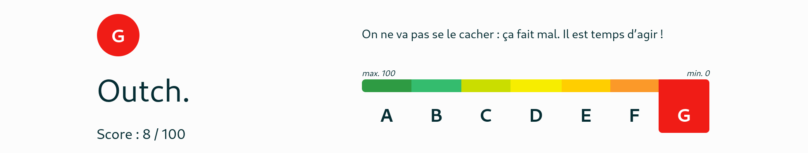
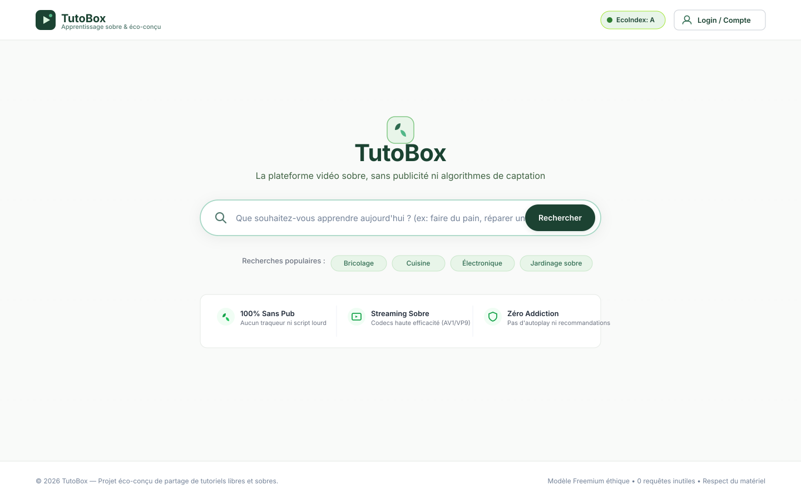
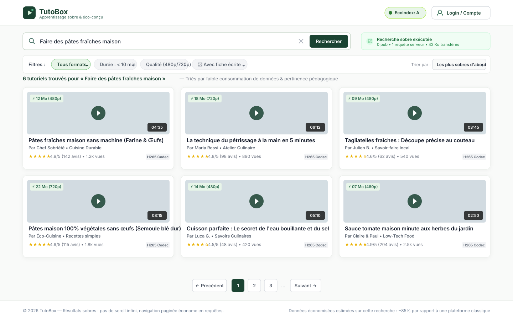
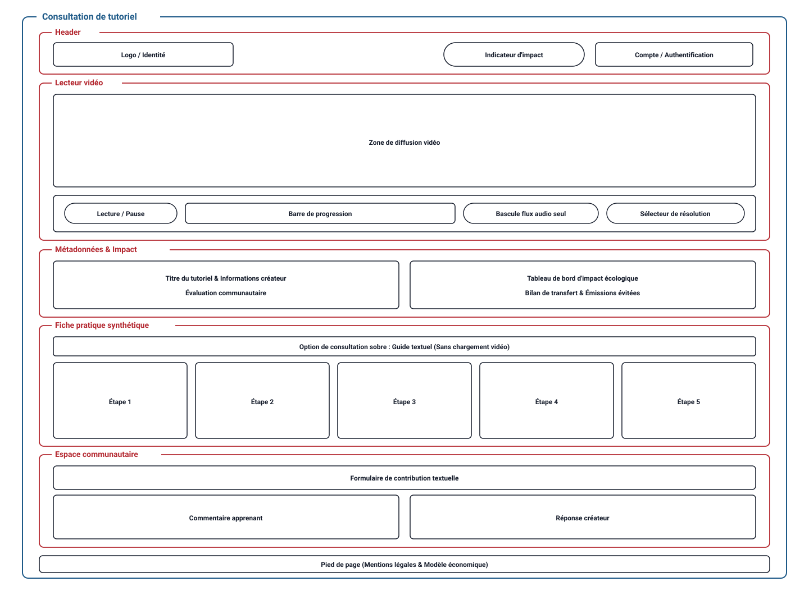
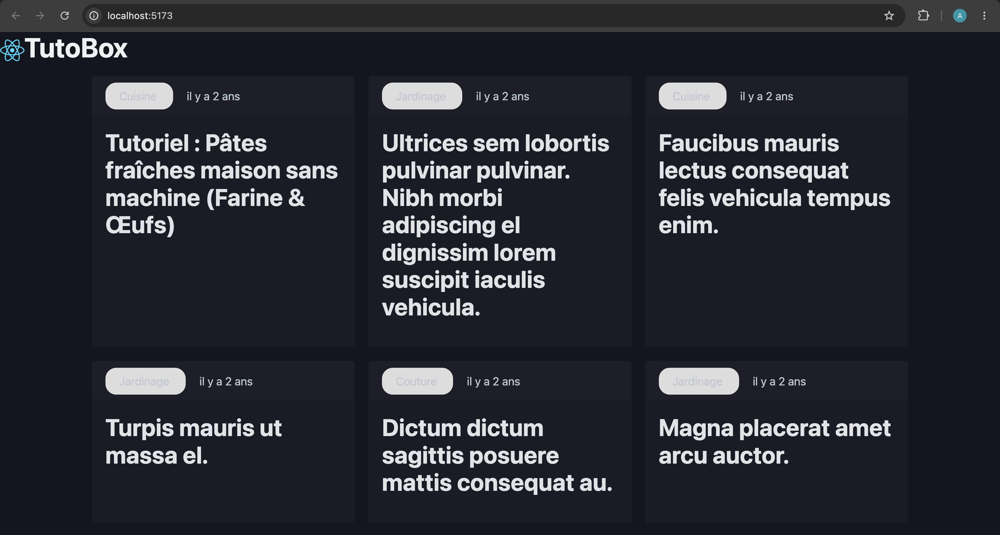
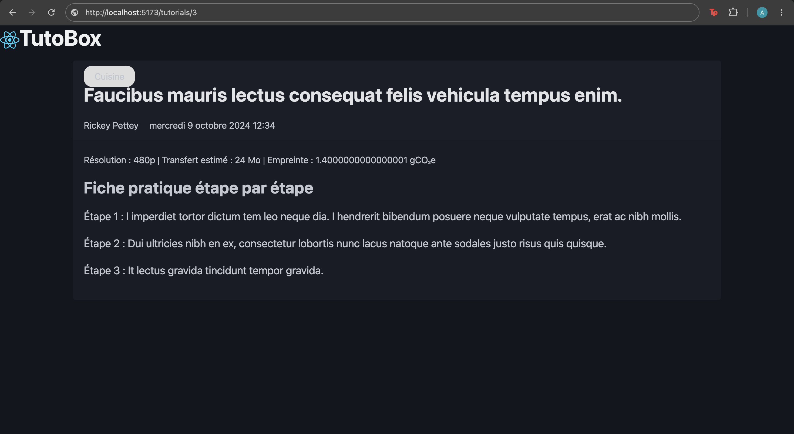

# TutoBox

## Introduction

Aujourd’hui, le streaming vidéo représente [entre 53.7 %](https://spacelift.io/blog/how-much-data-is-generated-every-day) du trafic Internet mondial, YouTube absorbant à lui seul [jusqu’à 14.6 %](https://spacelift.io/blog/how-much-data-is-generated-every-day) de la bande passante descendante du globe. Si les progrès technologiques ont réduit l'intensité énergétique unitaire par heure de visionnage (entre [46 gCO₂e](https://www.iea.org/commentaries/the-carbon-footprint-of-streaming-video-fact-checking-the-headlines)), les émissions globales d'Alphabet ont bondi de [57 %](https://www.smartenergydecisions.com/wp-content/uploads/2025/04/google-2024-environmental-report.pdf) en cinq ans, illustrant un effet rebond massif alimenté par la course aux très hautes résolutions (4K/8K) et la prolifération de fonctionnalités superflues. L’empreinte environnementale du service ne réside pas seulement dans les serveurs, mais d'abord sur les terminaux utilisateurs ([50 à 70 %](https://computingwithinlimits.org/2022/papers/limits22-final-Makonin.pdf) de l'impact) et dans des interfaces web surchargées : le site de YouTube écope d’un score EcoIndex désastreux ([classe G](https://www.ecoindex.fr/)) en raison de scripts invasifs, d'un arbre DOM pléthorique et de flux vidéo maintenus même lorsqu'ils sont hors champ (soit environ [323 000 tCO₂e / an](https://www.fastcompany.com/90346595/the-internets-youtube-habit-has-the-carbon-footprint-of-a-small-city) évitables).



Face à cette dérive, le projet TutoBox propose une alternative dédiée à l'apprentissage et guidée par la sobriété numérique. En reprenant l'efficacité pédagogique de la vidéo tout en intégrant une écoconception stricte (allègement drastique de l'interface, résolutions adaptées à l'échelle d'apprentissage, suspension du flux vidéo masqué et absence d'algorithmes de captation de l'attention), TutoBox prouve qu'il est possible de transmettre le savoir sans saturer les réseaux ni épuiser les ressources planétaires.

---

## De YouTube vers TutoBox : Grille d'évaluation sociotechnique

### 1. Plan médico-social

- **Apprentissage et émancipation technique :** Facilite la montée en compétences en autonomie dans des domaines variés (programmation, artisanat, réparation d'objets, sciences), favorisant l'apprentissage tout au long de la vie sans distraction attentionnelle.
- **Santé publique et prévention des risques :** Diffusion rapide et accessible de tutoriels d'intérêt général (gestes de premiers secours, réflexes en cas d'accident, prévention sanitaire, ergonomie).
- **Santé mentale et sobriété cognitive :** En éliminant le design persuasif (recommandations algorithmiques addictives, notifications anxiogènes, lecture automatique), la plateforme protège l'attention des usagers et réduit la fatigue numérique.
- **Lien social et valorisation humaine :** Création d'opportunités d'entraide communautaire et génération d'emplois locaux dédiés à l'animation, la modération éthique et la maintenance technique de l'infrastructure sobre.

### 2. Plan du développement d'un territoire

- **Souveraineté fiscale et économique :** Contrairement aux modèles des multinationales du numérique (comme Alphabet) recourant à l'optimisation fiscale transfrontalière, TutoBox s'inscrit dans l'économie locale et contribue directement aux recettes publiques territoriales (notamment via l'impôt sur les sociétés).
- **Épanouissement des populations et résilience locale :** Démocratisation des savoirs pratiques et valorisation des savoir-faire régionaux (circuits courts, low-tech, maintenance locale). La faible bande passante requise permet un accès équitable aux formations, y compris dans les zones rurales ou à connectivité limitée.
- **Emplois locaux durables :** Soutien à des emplois techniques et pédagogiques non délocalisables (hébergement souverain, maintenance logicielle éco-conçue, médiation numérique et accompagnement de proximité).

### 3. Démocratie technique

- **Marge d’appropriation :** Les apprenants et créateurs ne sont plus de simples consommateurs passifs d'un algorithme opaque, mais des acteurs qui s'approprient un outil transparent, configurable et adapté à leurs besoins réels.
- **Intelligibilité et clarté du système :** Conception intuitive sans pièges ergonomiques (_dark patterns_). L'usager maîtrise son parcours : la navigation est directe, sans fioritures, et les impacts de ses choix techniques (résolution, consommation de données) lui sont explicites.
- **Gouvernance et implication des usagers :** Mise en place de canaux de retour d'expérience (_feedback_) et consultation régulière des utilisateurs pour faire évoluer la plateforme selon des besoins d'intérêt général et non des impératifs publicitaires.
- **Utilité collective prioritaire :** Recentrage de l'outil sur des finalités sociales tangibles (transmission du savoir, culture, éducation) plutôt que sur la captation et la monétisation du « temps de cerveau disponible ».

### 4. Substitution effective à des dispositifs existants

- **Alternative éco-conçue et ciblée :** TutoBox se positionne comme une substitution directe à l'usage éducatif de plateformes généralistes comme YouTube, en expurgeant les couches superflues (scripts publicitaires lourds, traqueurs, modules d'engagement artificiel).
- **Optimisation de l'encodage et de la compression :** Utilisation de codecs vidéo modernes à haute efficacité de compression (tels que le H.265/HEVC, VP9 ou AV1) pour réduire drastiquement le volume de données transféré par rapport aux formats plus anciens (comme le H.264/AVC, historiquement conservé par commodité et coût de licences).
- **Diffusion sobre et adaptative :** Limitation des résolutions aux stricts besoins pédagogiques (la 480p ou 720p suffit amplement pour un tutoriel) et coupure automatique de la vidéo lorsque le lecteur sort du champ de vision ou que l'onglet est inactif (passage en flux audio seul).
- **Dashboard de sensibilisation :** Intégration d'un tableau de bord de suivi d'impact (données consommées en Mo, estimation gCO₂e évitée) afin de rendre visible la matérialité du numérique et d'encourager des usages responsables.

### 5. Effet rebond : analyse critique et leviers de régulation

- **Surconsommation induite (Effet Jevons) :** Rendre l'accès aux vidéos plus léger, plus rapide et moins coûteux risque paradoxalement d'encourager un visionnage compulsif et démultiplié, venant annuler les gains énergétiques par unité consommée.
- **Multiplication des infrastructures :** L'émergence d'une nouvelle plateforme risque d'additionner des serveurs supplémentaires sans nécessairement faire disparaître les infrastructures existantes, accentuant la consommation électrique globale si la substitution n'est pas totale.
- **Inflation des formats (texte vs vidéo) :** Tendance à privilégier une vidéo de 10 minutes (plusieurs centaines de mégaoctets) là où une fiche technique ou un texte illustré de quelques dizaines de kilo-octets suffirait pour documenter une démarche.
- **Bénéfice net sur la mobilité :** La formation à distance par tutoriels permet d'éviter des déplacements physiques en véhicule, à condition que le coût environnemental des données transférées demeure inférieur à celui du transport évité.
- **Dispositifs de régulation intégrés à TutoBox :**
  - Suppression radicale de la lecture automatique (_autoplay_) et du défilement infini de suggestions.
  - Mise en avant de résumés textuels, schémas synthétiques et chapitrages précis, évitant de charger une vidéo complète pour consulter une information ponctuelle.
  - Mesure et transparence de l'empreinte pour inciter à l'auto-régulation.

---

## Plateformes de référence et scénarios d'usage

### Plateformes et alternatives de référence

TutoBox s'évalue et se positionne face à plusieurs acteurs existants de la vidéo et du tutoriel :

- **Plateformes vidéo généralistes :** YouTube, Dailymotion, Vimeo
- **Plateformes de cours, académiques et tutoriels :** Tuto.com, POD UTT

### Scénarios utilisateurs

#### 1. Scénario : « Apprendre à faire des pâtes »

1. **Besoin initial :** L'utilisateur ne trouve pas l'information dans des livres ou à portée de main.
2. **Accès à la plateforme :** Ouvre le navigateur et se rend sur **TutoBox**.
3. **Recherche :** Fait une recherche par mots-clés.
4. **Sélection :** Clique sur le tutoriel avec le meilleur ratio like / dislike ou le plus consulté.
5. **Consultation :** Regarde le premier tutoriel.
6. **Résultat :** L'utilisateur sait faire des pâtes.

#### 2. Scénario : « Apprendre à faire des pâtes (l’utilisateur connaît un créateur) »

1. **Besoin initial :** L'utilisateur ne trouve pas l'information dans des livres ou à portée de main, mais connaît déjà un créateur.
2. **Accès à la plateforme :** Ouvre le navigateur et se rend sur **TutoBox**.
3. **Recherche :** Fait une recherche par créateur.
4. **Sélection :** Clique sur le tutoriel qui correspond.
5. **Résultat :** L'utilisateur sait faire des pâtes.

## Impact de l'exécution des scénarios auprès de différents services concurrents

L'EcoIndex d'une page (de A à G) est calculé (à l'aide des outils tels que [EcoIndex](https://www.ecoindex.fr/) ou [GreenIT](https://www.greenit.fr/)) en fonction du positionnement de cette page parmi les pages mondiales concernant:

- Le nombre de requêtes lancées
- Le poids de la page
- Le nombre d'éléments de la page

Nous avons donc comparé l'impact des scénarios sur les différents sites qui fournissent un l'accès à des tutoriels: YouTube, tuto.com, Vimeo, DailyMotion, POD UTT.

| Site Web    | Score (sur 100) | Classe | Détail des mesures                                                           |
| ----------- | --------------- | ------ | ---------------------------------------------------------------------------- |
| POD UTT     | 61/100          | C      | [Plus de détails](Benchmark/POD_UTT/EcoIndex-environmental-statement.md)     |
| DailyMotion | 24/100          | F      | [Plus de détails](Benchmark/DailyMotion/EcoIndex-environmental-statement.md) |
| Vimeo       | 18/100          | F      | [Plus de détails](Benchmark/Vimeo/Ecoindex-environmental-statement.md)       |
| tuto.com    | 15/100          | F      | [Plus de détails](Benchmark/Tuto.com/EcoIndex-environmental-statement.md)    |
| YouTube     | 8/100           | G      | [Plus de détails](Benchmark/YouTube/EcoIndex-environmental-statement.md)     |

**Tab 1:** Mesure de l'EcoIndex moyen des service fournissant l'accès aux tutoriels.

Les mesures de l'impact de ces services révèlent des disparités notables : les plateformes commerciales grand public présentent des classes EcoIndex très faibles (F, et G pour YouTube), tandis qu'une plateforme sobre comme POD UTT atteint la classe C (61/100).

Dans le détail, les pages les plus mal classées sont celles qui incluent:

- Des vidéos
- Des designs graphiques très lourds
- Des traqueurs en très grand nombre
- Des publicités en grand nombre

Il est donc nécessaires d'appliquer des pratiques d'écoconception et un modèle économique permettant de réduire le recours à des services publiciataires et de traqueurs.

## Modèle économique

Comme nous l'avons vu dans la section précédente, parmi les choix de conception ayant un important impact environnemental, la plupart sont directement liés au modèle économique du service. C'est pourquoi il est donc nécessaire d'effectuer une analyse profonde de ces modèles économiques afin de choisir un meilleur modèle économique pour la conception de notre projet.

En effet, le monde du streaming vidéo est un domaine assez capitaliste où la réalisation des profits passe avant la réduction de l'impact environnementale du produit. Au vue de la concurrence dans ce secteur chaque plateforme de streaming vidéo ou de tutoriels disposent de son propre modèle économique afin d'attirer le plus d'utilisateurs.

| Plateforme      | Modèle d'accès                         | Source de financement                                | Publicités & Traqueurs                   |
| --------------- | -------------------------------------- | ---------------------------------------------------- | ---------------------------------------- |
| **YouTube**     | Gratuit / Freemium (_YouTube Premium_) | Publicités ciblées (Google Ads), abonnements payants | Publicités omniprésentes, traçage massif |
| **DailyMotion** | Gratuit                                | Publicités vidéo (régies tierces)                    | Publicités pré/mid-roll, traqueurs tiers |
| **Vimeo**       | Freemium                               | Abonnements créateurs et entreprises                 | Aucune publicité tierce sur les vidéos   |
| **tuto.com**    | Payant (à l'acte ou abonnement)        | Achat direct de formations, abonnements              | Absence de traqueurs publicitaires tiers |
| **POD UTT**     | Gratuit                                | Financement public / institutionnel (université)     | Aucune publicité, aucun traqueur         |

**Tab. 2 :** Offre des services de diffusion vidéo et tutoriels.

Les offres de service numérique des plateformes de vidéo et de tutoriels (cf. Tab. 2) se sont principalement polarisées autour de deux modèles :

- un accès gratuit financé par la publicité et la captation de l'attention (YouTube, DailyMotion), qui génère une surcharge de requêtes, des traqueurs invasifs et une course aux clics écologiquement insoutenable ;
- un accès payant (par abonnement ou achat unitaire comme tuto.com et Vimeo) ou institutionnel (POD UTT), qui élimine les traqueurs publicitaires mais peut représenter une barrière d'entrée immédiate pour les apprenants.

Afin de concilier accessibilité, pérennité et sobriété numérique, **TutoBox** fait le choix d'exclure totalement la publicité et propose un modèle de type **Freemium avec période d'essai** :

- **Période d'essai pour les apprenants :** Les utilisateurs peuvent accéder gratuitement au système de façon limitée pendant une période d'essai d'**une semaine avec 10 vidéos incluses** ;
- **Abonnement standard :** S'ils souhaitent visionner davantage de vidéos, l'accès bascule sur un système d'abonnement standard à prix modéré (**7 € / mois**) ;
- **Exonération pour les créateurs :** Les créateurs de contenu sont totalement exonérés de cette limite pour publier des vidéos ;
- **Gratification par paliers (_milestones_) :** Si les créateurs atteignent un certain palier (_milestones_), ils peuvent accéder à toute la plateforme gratuitement.

| Source de revenus       | Montant unitaire | Quantité nécessaire pour financer un salaire[^1] |
| ----------------------- | ---------------- | ------------------------------------------------ |
| **Abonnement standard** | 7 € [^2]         | 501                                              |

**Tab. 3 :** Source de revenus retenue pour le service TutoBox.

L'étude de l'offre des plateformes existantes (cf. Tab. 2) et l'évaluation des besoins financiers (cf. Tab. 3) nous ont permis d'établir que :

- le recours à la publicité est incompatible avec les objectifs de sobriété de TutoBox : il dégrade drastiquement le score EcoIndex, alourdit les pages en scripts de traçage et incite structurellement au visionnage compulsif ;
- un modèle économique sain et 100 % sans publicité est pleinement viable : avec un abonnement standard accessible fixé à 7 €, seuls **501 abonnements** sont nécessaires pour financer le salaire médian d'un employé (3 507 €) ;
- l'exonération des créateurs et l'accès gratuit par paliers (_milestones_) encouragent l'enrichissement de la plateforme en tutoriels de qualité tout en maintenant un modèle équilibré et autonome.

Par conséquent, pour réduire drastiquement l'impact écologique du service tout en garantissant sa viabilité économique, nous proposons de :

- renoncer totalement et définitivement à toute forme de publicité et de traqueurs ;
- baser le modèle de financement exclusivement sur l'abonnement standard (7 € / mois) ;
- instaurer une période d'essai gratuite et sobre (1 semaine avec 10 vidéos incluses) pour faciliter l'accès initial aux savoirs ;
- exonérer les créateurs de limites pour publier des tutoriels et leur offrir la gratuité complète dès l'atteinte de jalons (_milestones_).

[^1]: Basé sur un salaire médian chargé estimé à 3 507 € pour financer un employé.

[^2]: Montant unitaire de l'abonnement standard TutoBox (3 507 € / 7 € = 501 abonnements nécessaires).

---

## Maquette de l'interface et échantillon de données

Au vu des différents services comparés, des exigences environnementales exprimées plus haut et des scénarios retenus, nous avons défini pour notre prototype une maquette de l'interface et un échantillon de données réalistes.

Les ressources Web possédant une représentation sur notre application sont structurées autour des objets métiers suivants :

- **Le point d'entrée du service** (avec une HTTP-URI ayant pour chemin `/`) ;
- **La recherche et filtrage de tutoriels**, accessible via la commande de recherche `search` (avec pour chemin `/search?q={query}`), ou plus spécifiquement filtrée par rubrique thématique (`/search?topic={name}`) ou par créateur (`/search?creator={name}`) ;
- **Le tutoriel** (avec pour chemin `/tutorials/{id}`), représentant l'objet métier central du tutoriel avec son lecteur vidéo éco-conçu, ses métadonnées techniques, son indicateur d'impact environnemental et sa fiche textuelle synthétique.

### Maquettes de l'interface

#### a. Point d'entrée sobre (`/`)

Le point d'entrée propose une interface épurée centrée sur un champ de recherche direct, des raccourcis vers les thématiques sobres courantes et un rappel des engagements écologiques du service, sans flux vidéo en arrière-plan ni recommandations superflues.



#### b. Recherche et filtrage de tutoriels (`/search?q={query}`)

La commande de recherche présente les résultats sous forme de cartes synthétiques allégées, avec des filtres sobres (durée, format, qualité 480p/720p, présence d'une fiche écrite). Pour l'affichage de ces résultats, un composant réutilisable « aperçu » est créé et réutilisé pour chaque aperçu de tutoriel, garantissant une cohérence visuelle et une modularité optimale du code. Chaque aperçu affiche explicitement son coût estimé en transfert de données et en émissions carbone.



#### c. Consultation et visionnage d'un tutoriel (`/tutorials/{id}`)

Le tutoriel intègre un lecteur sans lecture automatique (_autoplay_), diffusant par défaut en résolution éco (480p) avec bascule en flux audio seul et coupure automatique lorsque l'onglet est inactif. Une fiche résumée étape par étape permet d'accéder directement à l'information sans charger l'intégralité du média vidéo.



**Fig. 1 :** Maquette de l'interface du prototype : a. Point d'entrée sobre (`/`), b. Recherche et filtrage de tutoriels (`/search?q={query}`), c. Consultation et visionnage d'un tutoriel (`/tutorials/{id}`).

### Échantillon et modèle de données

Dans un objectif de sobriété environnementale, les tutoriels sont pour l'instant limités à un échantillon restreint et représentatif (soit `20` à `30` tutoriels ciblant les scénarios pratiques : cuisine sobre, réparation, bricolage, jardinage).

Pour des raisons de respect des droits d'auteurs, nous utilisons des données générées (avec [`dummy-json`](https://github.com/webroo/dummy-json/blob/master/README.md)).
Bien que fictives, ces données correspondent rigoureusement à la structure des services concurrents et aux exigences de sobriété : chaque tutoriel comporte un titre (`heading`), une rubrique (`section`), une date de publication (`issued`), des informations sur l'auteur (`creator`), une durée (`duration_seconds`), des métriques d'impact écologique (`eco_metrics` : résolution par défaut, volume transféré en Mo, émissions gCO₂e évitées, codecs et bascule audio seul), des évaluations communautaires (`ratings`), ainsi qu'une fiche pratique découpée par étapes (`written_guide`) permettant l'apprentissage sans charger le média vidéo (voir [modèle de données](sample_data.hbs)).

Le fichier généré (`sample_data.json`) n'est pas versionné : il est produit à chaque intégration continue à partir de `sample_data.hbs`, ce qui évite de stocker dans Git un fichier dont la taille augmente avec le catalogue (2,9 Mo dans la simulation de passage à l'échelle). En local, il s'obtient avec `npx dummy-json sample_data.hbs > frontend/public/sample_data.json`.

## Implémentation du scénario prioritaire

### Étape de prototypage: Données chargées de manière statique

Pour cette première version du prototype (v1.0.0), nous avons les caractéristiques suivantes:

- L'échantillon de données est chargé dans le code de manière statique
- Les différentes fonctionnalités implémentées ne sont que celles nécessaires pour suivre le scénario prioritaire: Apprendre à faire des pâtes (en entrant directement les mots-clés dans la barre de recherche).

Ce scénario nécessite de pouvoir naviguer entre deux types de page: la page d'accueil (le point d'entrée sobre) et la page de consultation et de visionnage du tutoriel.

### Point d'entrée sobre (La page d'accueil)

La page de titre que nous avons développé se rapproche de la maquette que nous avions préalablement mis sur pied.



**Fig.2:** Prototype de la page d'accueil

Pour concevoir l'interface de notre application de tutoriels, nous avons opté pour PicoCSS (version 2.1.1), un framework minimaliste qui allège considérablement le poids des feuilles de style par rapport à des solutions plus denses. Nous pourrons réévaluer l'impact écologique de ce choix si l'intégration future d'un outil plus lourd s'avère indispensable.   

Dans une démarche d'écoconception et de sobriété numérique, nous avons choisi de proscrire les illustrations et photographies sur la page d'accueil, à l'inverse des standards actuels du marché. Bien que ces visuels captent l'attention, ils s'avèrent superflus pour accéder directement aux titres des tutoriels dans cette version minimale. L'ajout d'images nécessiterait des requêtes HTTP supplémentaires et des stratégies d'optimisation complexes (telles que le multiplexage HTTP/2 ou les sprites CSS) dont le rapport coût-bénéfice environnemental reste discutable.

L'analyse de notre fichier de configuration met en lumière une pile technique moderne et resserrée autour de React (v19.3.1) et de React Router (v8.4.0) pour la navigation, secondés par DayJS (v1.11.23) pour un traitement léger des dates. Même si la couche de données dynamique reste à intégrer, l'évaluation énergétique du prototype est d'ores et déjà très satisfaisante. Grâce au bundler ultra-rapide Vite (v8.3.4) et à son moteur Rolldown, le code bénéficie d'une minification rigoureuse et d'une concaténation optimale des modules, réduisant ainsi l'empreinte de l'application tant en phase de développement qu'en pré-production.

|  | **EcoIndex** |**EcoIndex score** | **GES (gCO2e)** | **Taille du DOM** | **Requêtes** | **Taille de la page (Ko)** |
|---|---|---|---|---|---|---|
| Mode "développement" |72/100 | B | 1.56 | 172 | 25 | 5600 |
| Mode "pré-production" | 89/100 | A | 1.83 | 171 | 4 | 108 |

**Tab.4:** Évaluation de l'impact du prototype de la page d'accueil.

### Page de visualisation des tutoriels

Les pages des tutoriels ont pour forme `http://localhost:5173/tutorials/{id}`. Comme l'échantillon de données comportait déjà des ids, chaque tutoriel peut directement être déterminé par leurs identifiants (par exemple `http://localhost:5173/tutorials/3`).

De même que précédemment, nous avons tenté d'implémenter cette page (cf. Fig. 3) conformément à ce que prévoyait la maquette. La page de consultation permet d'accéder au détail d'un tutoriel sélectionné (fiche pratique étape par étape, métriques écologiques, informations sur l'auteur).



**Fig. 3 :** Prototype de la page de visualisation d'un tutoriel

|  | **EcoIndex** |**EcoIndex score** | **GES (gCO2e)** | **Taille du DOM** | **Requêtes** | **Taille de la page (Ko)** |
|---|---|---|---|---|---|---|
| Rechercher la vidéo souhaité| 86 | B | 1.29 | 182 | 26 | 5590 |
| Trouver la vidéo du tutoriel| 93 | A | 1.13 | 30 | 28 | 5590 |
| Ouvrir la vidéo et visionner | 93 | A | 1.13 | 30 | 28 | 5590 |

**Tab.5:** Évaluation de l'impact du prototype de la page de consultation d'un tutoriel (v1.0.0).

---

### Étape de prototypage : Données chargées de manière dynamique (v1.0.1)

Pour cette seconde version du prototype (v1.0.1), l'objectif est d'effectuer la transition d'un modèle statique intégré à la compilation vers un chargement dynamique asynchrone des données, représentatif d'une architecture client-serveur éco-conçue :

- **Découplage des données et du bundle applicatif** : L'échantillon de données (`sample_data.json`) a été extrait des composants React et déplacé dans le répertoire `public/` afin d'être servi comme ressource statique accessible via une URL HTTP.
- **Récupération asynchrone (`fetch`) et promesses (`Promise.then`)** : Les composants interrogent désormais la ressource via l'API standard `fetch('/sample_data.json')` de façon non-bloquante pour le navigateur.
- **Cycle de vie et réactivité (`useEffect` & `useState`)** :
  - `useEffect()` orchestre le déclenchement de la requête au montage du composant dans le DOM (avec un tableau de dépendances vide `[]` pour la page d'accueil et dépendant de l'identifiant `[id]` pour la page de consultation de tutoriel).
  - `useState()` stocke les données reçues. Contrairement à une variable JavaScript ordinaire, la modification d'un état React notifie le moteur de rendu et déclenche la mise à jour réactive de l'interface utilisateur dès la résolution de la promesse réseau.

#### Évaluation de l'impact et analyse comparative (v1.0.0 vs v1.0.1)

| Version | Mode | **EcoIndex** | **EcoIndex score** | **GES (gCO2e)** | **Eau (cl)** | **Taille du DOM** | **Requêtes** | **Taille totale (Ko)** | **Taille du bundle JS (Ko)** |
|---|---|---|---|---|---|---|---|---|---|
| **v1.0.0** (Statique) | Pré-production | 89/100 | A | 1.83 | - | 171 | 4 | 108 | 292.8 |
| **v1.0.1** (Dynamique) | Pré-production | 92/100 (91.82) | A | 1.16 | 1.75 | 179 | 5 | 136 | 272.4 (-20.4 Ko) |

**Tab.6:** Comparaison d'impact environnemental entre la version statique (v1.0.0) et la version dynamique (v1.0.1).

*Analyse des écarts observés :*
- **Score EcoIndex et émissions GES** : L'EcoIndex progresse à **92/100 (score A)** avec une baisse significative des émissions de gaz à effet de serre (**1,16 gCO₂e** contre 1,83 gCO₂e en v1.0.0) et une consommation d'eau mesurée à **1,75 cl**.
- **Allègement du bundle applicatif** : L'exclusion des données JSON lors du bundling Vite permet de réduire la taille du bundle JavaScript principal de **292,8 Ko à 272,4 Ko** (-20,4 Ko brut, -6 Ko gzippé). Le code applicatif est dissocié du contenu éditorial.
- **Requête réseau supplémentaire** : Le chargement dynamique introduit **1 requête HTTP supplémentaire** (5 requêtes au total contre 4) pour acheminer `sample_data.json` de façon asynchrone, portant le volume total transféré à environ 136 Ko.
- **Taille du DOM** : Légère variation du nombre de nœuds dans le DOM (179 éléments), cohérente avec le cycle de rendu asynchrone orchestré par `useState` et `useEffect`.

### Mesure de la consommation énergétique lors du passage à l'échelle

Maintenant que notre prototype est réaliste en termes de nombre de requêtes, nous pouvons simuler les effets du "passage à l'échelle".

Dans le cas qui nous occupe du visionnage des tutoriels, l'augmentation de la quantité des données à traiter ne viendra ni de l'augmentation du nombre de créateurs ni même de celle des utilisateurs de la plateforme. Par contre, il est d'usage sur les plateformes de tutoriels d'avoir accès aux anciens tutoriels qui permettent toujours de résoudre des problèmes actuelles (recettes de cuisine, nettoyage). Cette exigence fonctionnelle bien que coûteuse du point de vue environnemental nous semble contribuer grandement à l'utilité sociale et éducative de la plateforme. Par conséquent nous adopterons également ce choix de conception.

### Quelles données se multiplient avec l'usage ?

Une application qui ne change pas de code peut néanmoins changer d'impact, parce que les données qu'elle manipule grossissent avec son usage. Dans TutoBox, quatre familles de données sont concernées, mais une seule pèse réellement :

| Donnée | Nature de la croissance | Ordre de grandeur | Effet sur l'impact |
|---|---|---|---|
| Catalogue des tutoriels (`tutorials`) | contenu qui ne disparaît jamais, alimenté par les créateurs | 25 publications/jour → **2 600 tutoriels en 3,5 mois**, ~9 000 au bout d'un an | **déterminant** : une carte par tutoriel sur l'accueil (donc du DOM), et le fichier entier est retéléchargé par *chaque* page |
| Compteurs d'audience (`views_count`, `ratings`, `creator.subscribers`) | proportionnels au trafic | quelques octets par tutoriel | négligeable en poids, mais croît indéfiniment |
| Fiche pratique (`written_guide`) | fixée une fois par le créateur | 3 à 6 étapes | négligeable |
| Journaux de consultation, historique (non implémentés) | linéaires au trafic | — | hors prototype, mais à anticiper |

La taille d'un tutoriel dans `sample_data.json` est d'environ **1,1 Ko** : le fichier passe donc de 25 Ko (20-30 tutoriels) à **2,9 Mo** pour 2 600 tutoriels, et à plus de 10 Mo au bout d'un an. C'est cet ordre de grandeur — **× 100** — que nous simulons ci-dessous, en passant la répétition de `sample_data.hbs` de `min=20 max=30` à `2600`.

### Mesure automatisée de l'EcoIndex

Pour que les mesures soient disponibles publiquement et reproductibles, elles ne sont plus produites à la main dans un navigateur mais **à chaque push**, dans l'intégration continue :

1. le scénario prioritaire est décrit dans [`scenarios/learn_to_make_pasta.yml`](scenarios/learn_to_make_pasta.yml) : chargement de l'accueil, clic sur le premier tutoriel (« Pâtes fraîches maison »), défilement de la fiche pratique, retour à l'accueil ;
2. le job `measure_ecoindex` démarre l'application avec nginx (action composite `start`), installe [GreenIT Analysis CLI](https://github.com/cnumr/GreenIT-Analysis-cli) et exécute `greenit analyse scenarios/learn_to_make_pasta.yml EcoIndex.html --format html --ci` ;
3. les rapports HTML (rapport global + rapport détaillé du scénario) sont publiés en **artefacts** du run ;
4. `sample_data.json` n'est plus versionné : il est regénéré à chaque run avec `dummy-json` à partir de [`sample_data.hbs`](sample_data.hbs), puis placé dans `frontend/public/` avant le build.

En local, la même mesure s'obtient avec :

```bash
cd frontend && npm run build && cd ..
docker compose up --detach
greenit analyse scenarios/learn_to_make_pasta.yml EcoIndex.html --format html
```

Les deux mesures commentées ci-dessous sont disponibles en artefacts : [avant](https://github.com/UTT-GL03/TutoBox/actions/runs/43881111079/artifacts/14231609183) et [après](https://github.com/UTT-GL03/TutoBox/actions/runs/43882537957/artifacts/14233267413) le passage à l'échelle. Le scénario complet s'exécute en une dizaine de secondes dans les deux cas : c'est l'empreinte qui augmente, pas la durée du test.

#### Évolution de l'EcoIndex lors du passage à l'échelle

| Étape | **EcoIndex** |**Score** | **GES (gCO₂e)** | **Eau (cl)** | **Taille du DOM** | **Requêtes** | **Taille de la page (Ko)** |
|---|---|---|---|---|---|---|---|
| Chargement de la page | <del>81</del><br/>32 | <del>A</del><br/>E | <del>1,38</del><br/>2,36 | <del>2,07</del><br/>3,54 | <del>198</del><br/>16 481 | 6 | <del>397</del><br/>3 300 |
| Ouvrir le tutoriel | <del>91</del><br/>79 | A | <del>1,18</del><br/>1,42 | <del>1,77</del><br/>2,13 | 30 | 2 | <del>34</del><br/>2 937 |
| Revenir à l'accueil | <del>83</del><br/>33 | <del>A</del><br/>E | <del>1,34</del><br/>2,34 | <del>2,01</del><br/>3,51 | <del>198</del><br/>16 481 | 2 | <del>34</del><br/>2 937 |

**Tab.7:** Effet du passage à l'échelle (2 600 tutoriels) sur l'impact du scénario "Apprendre à faire des pâtes" dans le prototype v1.0.1. Valeurs barrées : avant (`sample_data.hbs` à 20-30 tutoriels) ; valeurs en clair : après.

Ces valeurs sont reproductibles : chaque état a été mesuré deux fois de suite, avec des chiffres identiques. Cela a demandé une correction du scénario : l'attente porte désormais sur la **dernière ligne de cartes** (`main.container > div.grid:last-child`) et non sur la première, sans quoi GreenIT peut prendre la mesure avant que React ait rendu les 2 600 cartes (14 nœuds au lieu de 16 481, EcoIndex 94 au lieu de 33). L'artefact [avant](https://github.com/UTT-GL03/TutoBox/actions/runs/43881111079/artifacts/14231609183) a été produit avec la version initiale du scénario, d'où un DOM de 141 nœuds au lieu de 198.

| Scénario complet (3 étapes) | Avant | Après | Écart |
|---|---|---|---|
| Données transférées par visite | 464 Ko | 9 174 Ko | **× 19,8** |
| GES par visite | 3,90 gCO₂e | 6,12 gCO₂e | × 1,57 |
| Eau par visite | 5,85 cl | 9,18 cl | × 1,57 |

**Tab.8:** Bilan du scénario avant et après passage à l'échelle.

La baisse de l'EcoIndex s'explique par deux mécanismes distincts, qu'il faut séparer :

- **Sur la page d'accueil**, l'EcoIndex chute de 81 (A) à 32 (E) parce que le nombre de cartes, donc d'éléments du DOM, est multiplié par **83** (198 → 16 481 nœuds). Le poids de la page ne progresse "que" de × 8,3 (397 → 3 300 Ko), mais l'EcoIndex intègre une part liée à la fabrication et à la fin de vie des terminaux, qui croît avec le nombre d'éléments à afficher. C'est exactement le même effet que sur la page des titres de QVOTIDIE (198 → 19 014 nœuds, 81 A → 29 E) : l'ordre de grandeur est cohérent, ce qui valide la mesure.
- **Sur la page d'un tutoriel**, la fiche affichée n'a pas changé d'un octet (30 nœuds de DOM avant, 28 après), et pourtant l'EcoIndex baisse de 91 (A) à 79 (A) et le poids transféré explose de 34 Ko à **2 937 Ko** (× 87). La cause est architecturale : `Tutorial.jsx` appelle `fetch('/sample_data.json')` puis filtre en mémoire. Afficher une fiche de trois étapes coûte donc désormais le téléchargement du catalogue entier — 2,9 Mo pour lire 1,1 Ko.

Trois enseignements pour la suite du projet :

- **Le nombre de requêtes est un mauvais indicateur ici** : il ne bouge pas (6 puis 2), alors que le volume est multiplié par 87. Un budget de requêtes ne suffit pas à protéger une application de ce type d'effet.
- **Les données croissent, les actifs non** : les 362 Ko d'actifs du build (JS 272 Ko, CSS 85 Ko, SVG 4 Ko, HTML 0,4 Ko) sont devenus négligeables devant les 2,9 Mo de données sur la page tutoriel, alors qu'ils dominaient complètement la v1.0.1 (397 Ko de page pour 35 Ko de données). Sur l'accueil, c'est l'inverse : le DOM et les données pèsent désormais plus que le code. GreenIT signale d'ailleurs deux bonnes pratiques non satisfaites qui pèseraient sur les deux tableaux : **aucun en-tête `Cache-Control`/`Expires`** sur les actifs (0 % de ressources cacheables) et **aucune compression** (0 % de ressources compressées, alors que le JS ferait 87,65 Ko gzippé au lieu de 272 Ko *in fine*), la configuration nginx de l'image officielle livrant `gzip` en commentaire.
- **Piste évidente** : ne plus télécharger le catalogue entier pour afficher un tutoriel. C'est précisément l'objet de l'étape suivante (introduction d'une base de données servant un seul tutoriel à la fois), et c'est la même trajectoire que celle suivie par QVOTIDIE entre v1.0.1 et v2.0.0.

